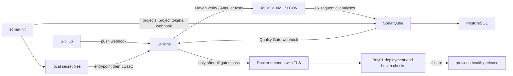

# Buy01 — Marketplace and CI/CD

Buy01 is a marketplace where clients browse products and sellers manage products and images. It has an Angular frontend and five Spring Boot services: User, Product, Media, API Gateway, and Eureka Discovery. MongoDB stores application data, Kafka carries events, and Cloudinary stores uploaded images.

This guide takes a new contributor from cloning the repository to opening the running application. The main deployment path uses Jenkins, SonarQube, and Docker Compose.

## Contents

- [Run the project from start to finish](#run-the-project-from-start-to-finish)
- [Daily use and shutdown](#daily-use-and-shutdown)
- [Run tests locally](#run-tests-locally)
- [Architecture](#architecture)
- [Infrastructure and secrets](#infrastructure-and-secrets)
- [Initial SonarQube setup and startup](#initial-sonarqube-setup-and-startup)
- [Build, coverage and deployment](#build-coverage-and-deployment)
- [GitHub triggers and Community Build](#github-triggers-and-community-build)
- [Troubleshooting](#troubleshooting)

## Run the project from start to finish

Run the commands below in **Bash on Linux**, from the repository root unless a command says otherwise. The commands assume a fresh installation. If you already have local configuration, certificates, or database volumes, preserve them and follow the migration notes later in this guide.

### 1. Install the prerequisites

You need:

- Git, OpenSSL, Docker Engine, and the Docker Compose v2 plugin. Your user must be able to run Docker commands.
- Internet access to download images, Jenkins plugins, Maven dependencies, and npm packages.
- A GitHub account and a token with read access to the repository used by Jenkins.
- A Cloudinary account and its cloud name, API key, and API secret for image uploads.
- Enough memory and disk for Jenkins, SonarQube, databases, and application builds. Around 8 GB of available RAM is a practical starting point; builds may need more.

Check your tools:

```bash
git --version
openssl version
docker version
docker compose version
```

Java, Maven, Node.js, and npm are supplied inside the Jenkins image for this deployment path. You only need to install them on your host if you want to run tests locally.

SonarQube uses Elasticsearch. Check the host setting before starting it:

```bash
sysctl vm.max_map_count
```

If it is below `524288`, configure it on your Linux host:

```bash
sudo sysctl -w vm.max_map_count=524288
```

To retain it after reboot, add `vm.max_map_count=524288` to a file under `/etc/sysctl.d/`, then run `sudo sysctl --system`. This requires host administrator access.

### 2. Clone the repository

```bash
git clone https://github.com/anass-asbai/safe-zone.git
cd safe-zone
```

If you use a fork, edit the repository URL in `jenkins-lab/jcasc/jenkins.yaml` to point to your fork. The `first-pipeline` job checks out the `main` branch and reads the root `Jenkinsfile`; your changes must be pushed to that repository before Jenkins can build them.

### 3. Prepare local configuration and secrets

```bash
umask 077
mkdir -p jenkins-lab/jenkins-secrets
chmod 700 jenkins-lab/jenkins-secrets
cp jenkins-lab/.env.example jenkins-lab/.env
cp .env.example jenkins-lab/jenkins-secrets/buy01-env
```

Edit `jenkins-lab/.env` and replace `SONAR_DB_PASSWORD` with a strong database password. Leave the volume names at their defaults for a fresh installation.

Edit `jenkins-lab/jenkins-secrets/buy01-env` and fill in:

| Variables | What to enter |
|---|---|
| `JWT_SECRET` | A random secret of at least 32 bytes, shared by User Service and Gateway. A 64-character hexadecimal value from `openssl rand -hex 32` works. |
| `JWT_EXPIRATION` | Token lifetime in milliseconds; for example, `86400000` is one day. |
| `SERVER_SSL_KEY_STORE_PASSWORD` | Password you will use when generating the PKCS12 file in step 4. |
| `CLOUDINARY_CLOUD_NAME`, `CLOUDINARY_API_KEY`, `CLOUDINARY_API_SECRET` | Your Cloudinary account credentials. |
| `MONGO_ROOT_USERNAME`, `MONGO_ROOT_PASSWORD` | MongoDB administrator credentials used during database initialization. |
| `PRODUCT_MONGO_*`, `MEDIA_MONGO_*`, `USER_MONGO_*` | Database names and separate usernames/passwords for each service. The example already supplies database names and usernames. |

The `SONAR_DB_PASSWORD` entry in the application example is not used by application containers; the infrastructure reads it from `jenkins-lab/.env`.

The pipeline sources `buy01-env` as a shell file during Gateway tests. Use valid `KEY=value` syntax and single-quote values containing shell special characters. For MongoDB passwords, hexadecimal values avoid URI encoding issues. Replace every example placeholder before continuing.

Create the Jenkins login and GitHub credentials using hidden prompts:

```bash
read -rsp 'Choose Jenkins admin password: ' setup_value
printf '\n'
printf '%s\n' "$setup_value" > jenkins-lab/jenkins-secrets/jenkins-admin-password
unset setup_value

read -rp 'GitHub username: ' setup_value
printf '%s\n' "$setup_value" > jenkins-lab/jenkins-secrets/github-username
unset setup_value

read -rsp 'GitHub token with repository read access: ' setup_value
printf '\n'
printf '%s\n' "$setup_value" > jenkins-lab/jenkins-secrets/github-pat
unset setup_value
```

For a fine-grained GitHub token, grant access to the selected repository and read access to its contents. Keep these local files out of Git.

### 4. Generate development HTTPS certificates

For a fresh local installation, generate a self-signed certificate for `localhost` and the internal `gateway` hostname:

```bash
openssl req -x509 -newkey rsa:2048 -sha256 -nodes -days 365 \
  -keyout jenkins-lab/jenkins-secrets/gateway-keystore.key \
  -out jenkins-lab/jenkins-secrets/gateway-keystore.crt \
  -subj '/CN=localhost' \
  -addext 'subjectAltName=DNS:localhost,DNS:gateway,IP:127.0.0.1'

openssl pkcs12 -export -name gateway \
  -inkey jenkins-lab/jenkins-secrets/gateway-keystore.key \
  -in jenkins-lab/jenkins-secrets/gateway-keystore.crt \
  -out jenkins-lab/jenkins-secrets/gateway-keystore.p12

chmod 600 jenkins-lab/.env jenkins-lab/jenkins-secrets/*
```

When OpenSSL asks for the export password, enter exactly the `SERVER_SSL_KEY_STORE_PASSWORD` value from step 3. The alias must be `gateway`. The certificate and key serve frontend HTTPS; the PKCS12 keystore serves Gateway HTTPS. For a public deployment, supply certificates valid for your actual domain instead.

### 5. Start SonarQube and provision its projects

```bash
docker compose -f jenkins-lab/compose.yml config --quiet
docker compose -f jenkins-lab/compose.yml up -d --wait --wait-timeout 900 sonar-db sonarqube
```

Open **http://localhost:9000**. On a fresh SonarQube instance, sign in with `admin` / `admin` and change the password when prompted. In **My Account → Security**, create an administrator **User Token**. This token provisions the projects and webhook; it is different from a Project Analysis Token.

Save it locally and run bootstrap:

```bash
read -rsp 'SonarQube administrator User Token: ' sonar_admin_token
printf '\n'
printf '%s\n' "$sonar_admin_token" > jenkins-lab/jenkins-secrets/sonar-bootstrap-token
unset sonar_admin_token
chmod 600 jenkins-lab/jenkins-secrets/sonar-bootstrap-token

docker compose -f jenkins-lab/compose.yml --profile bootstrap run --rm sonar-init
```

Bootstrap must finish successfully. It creates six projects, saves six project analysis tokens in the secrets directory, and registers the internal Jenkins webhook. See the detailed SonarQube setup below if a token already exists or provisioning fails.

### 6. Start Jenkins

```bash
docker compose -f jenkins-lab/compose.yml up -d --build --wait --wait-timeout 900 docker jenkins
docker compose -f jenkins-lab/compose.yml ps
```

The first image build can take several minutes. Open **http://localhost:8085** and log in as `admin` with the password you saved in step 3. Jenkins Configuration as Code creates the credentials, SonarQube connection, and `first-pipeline` job automatically.

### 7. Run the first build and deployment

In Jenkins, open **first-pipeline → Build Now**, then open the build's **Console Output**.

The pipeline:

1. Checks out the configured GitHub repository.
2. Runs tests and packages all five backend services.
3. Installs frontend dependencies, runs frontend tests with coverage, and builds Angular.
4. Analyzes all six components in SonarQube and waits for each Quality Gate.
5. Builds Docker images tagged with the Jenkins build number.
6. Stages HTTPS certificates and deploys the application with Compose on `main`.
7. Checks container health and records the successful release. If deployment health fails and a previous healthy release exists, it attempts rollback.

Wait for **SUCCESS**, and confirm the deployment and health-check stages actually ran. A failed Quality Gate stops deployment; inspect the failing project at http://localhost:9000, fix the reported issues, push your changes, and rebuild.

Application containers and images are created **inside `jenkins-docker`**, so inspect them with:

```bash
docker exec jenkins-docker docker ps
```

Running the root `docker compose up` alone is insufficient: that file expects prebuilt, tagged images and certificates at Jenkins-managed paths.

### 8. Open the app and verify the complete flow

Open **https://localhost:4200**. For the generated development certificate, trust the certificate locally or accept your browser's self-signed certificate warning.

Try the following:

1. Register a **SELLER** account at `/register`.
2. Open the seller dashboard, upload an image, and create a product using the available forms.
3. Sign out and register a **CLIENT** account.
4. Browse `/products` and check that the new product and image appear.
5. Open `/profile` and verify your account details load.

A new database starts without marketplace data, so an empty product list is expected before a seller adds products. Image uploads require working Cloudinary credentials.

You can also check frontend delivery and Gateway health through the frontend proxy:

```bash
curl -kfsS -o /dev/null https://localhost:4200/index.html
curl -kfsS https://localhost:4200/actuator/health
```

The health endpoint should return a response containing `"status":"UP"`. `-k` permits the self-signed development certificate.

| Component | Local address |
|---|---|
| Marketplace | https://localhost:4200 |
| Jenkins | http://localhost:8085 |
| SonarQube | http://localhost:9000 |
| Gateway | Access through frontend `/api/` and `/actuator/` routes |

Only frontend port `4200` is forwarded out of Docker-in-Docker. The Gateway's inner port mapping is not published to the host by the infrastructure Compose file.

## Daily use and shutdown

Start an already configured installation:

```bash
docker compose -f jenkins-lab/compose.yml up -d --build
```

Push changes to your configured repository and run **Build Now**, or configure the GitHub webhook described below to trigger builds automatically.

After editing a secret file, reload Jenkins credentials:

```bash
docker compose -f jenkins-lab/compose.yml up -d --force-recreate jenkins
```

Rebuild the pipeline to apply changed application credentials or certificates to the deployment. Changing MongoDB initialization passwords does not update users in existing database volumes.

Inspect logs:

```bash
docker compose -f jenkins-lab/compose.yml logs --tail=100 jenkins sonarqube
docker exec jenkins-docker docker logs --tail=100 buy01-gateway
docker exec jenkins-docker docker logs --tail=100 buy01-media-service
```

Stop the infrastructure and the nested application daemon without deleting data:

```bash
docker compose -f jenkins-lab/compose.yml stop
```

Named volumes retain Jenkins configuration, SonarQube data, and the nested Docker daemon's application data. Avoid `down -v` unless you intentionally want to erase the associated volumes.

## Run tests locally

For host-based development, use JDK 17 or 21 and Node.js 24.20.0, matching the repository's Java target and Jenkins Node image. Each backend has its own Maven Wrapper; there is no root Maven build. A global Angular CLI or Maven installation is unnecessary.

From the repository root, load the trusted application environment and test the backend services:

```bash
set -a
. jenkins-lab/jenkins-secrets/buy01-env
set +a

for service in product-service user-service media-service gateway discovery; do
  (cd "$service" && bash ./mvnw -B clean verify) || break
done
```

Run frontend tests and its production build:

```bash
cd frontend
npm ci
CI=true npm test -- --watch=false --coverage --coverage-reporters=lcov
npm run build
cd ..
```

Backend coverage is written to each service's `target/site/jacoco/jacoco.xml`; frontend LCOV is written to `frontend/coverage/frontend/lcov.info`. The Dockerfiles copy existing build outputs, so packaging must happen before building images.

`npm start` runs Angular's development server, but the frontend uses relative `/api` URLs and the deployed Nginx configuration supplies the API proxy. To use that development server with backend APIs, configure an Angular development proxy; the complete deployment above already provides routing.

## Architecture



## Infrastructure and secrets

Use Docker Engine and Compose v2 on Linux. SonarQube requires sufficient RAM and host Elasticsearch limits (including `vm.max_map_count >= 524288`); arrange these with your host administrator if startup reports a limit error. Ports are Jenkins `8085`, SonarQube `9000` on loopback, Jenkins agents `50000`, and frontend HTTPS `4200` forwarded through DinD.

The canonical combined infrastructure is `jenkins-lab/compose.yml`. Its Jenkins/DinD volume names are unchanged. Sonar volumes default to the existing `sonar-lab_*` names discovered in this repository's environment. Override those names in `jenkins-lab/.env` only when deliberately selecting another database. Jenkins, SonarQube, PostgreSQL and the bootstrap share `jenkins-network`; application containers live inside DinD.

If migrating the existing separate `sonar-lab` stack, stop its containers **before** starting combined Compose. Never mount a live PostgreSQL data directory into two database containers. Do not delete volumes:

```bash
# Only for migration from the old stack (does not remove volumes).
docker stop sonarqube sonarqube-postgres
```

Preserve existing secrets and `.env` files. For a new installation:

```bash
mkdir -p jenkins-lab/jenkins-secrets
chmod 700 jenkins-lab/jenkins-secrets
cp jenkins-lab/.env.example jenkins-lab/.env
```

Set `SONAR_DB_PASSWORD` in that local `.env`. For an existing database it must match its actual password; PostgreSQL initialization variables do not change an existing user's password. The root `.env.example` describes application variables; copy and configure it as `jenkins-lab/jenkins-secrets/buy01-env` for Jenkins deployments.

Supply these local files without committing them:

| File in `jenkins-lab/jenkins-secrets` | Purpose |
|---|---|
| `jenkins-admin-password` | Jenkins `admin` password |
| `github-username`, `github-pat` | existing GitHub checkout credentials |
| `buy01-env` | configured application environment |
| `gateway-keystore.p12`, `.crt`, `.key` | existing gateway TLS material; keep the password consistent with application configuration |
| `sonar-bootstrap-token` | administrator **User Token** for provisioning, never an analysis token |

Use secure local editing or a password manager to supply secret contents. Set files to mode `600`; the root entrypoint reads them before launching Jenkins as UID 1000. Existing credentials, certificates, authentication policy and job definition remain in JCasC. Local `.env` and secret directories are ignored by Git.

## Initial SonarQube setup and startup

From the repository root:

```bash
docker compose -f jenkins-lab/compose.yml config --quiet
docker compose -f jenkins-lab/compose.yml up -d --wait --wait-timeout 900 sonar-db sonarqube
```

Open http://localhost:9000. On a fresh instance only, use SonarQube's initial administrator login, immediately change its password, then generate an administrator User Token in **My Account → Security**. Save it as `jenkins-lab/jenkins-secrets/sonar-bootstrap-token`, mode `600`, using the hidden prompt below. For an existing instance use its real administrator account. Bootstrap requires project creation, execute-analysis and global webhook administration permissions; retain these permissions for the account owning its project tokens. No default administrator password is embedded in bootstrap.

```bash
# Bash: enter the real administrator User Token without echo or shell history.
umask 077
read -rsp 'SonarQube administrator User Token: ' sonar_admin_token
printf '\n'
printf '%s\n' "$sonar_admin_token" > jenkins-lab/jenkins-secrets/sonar-bootstrap-token
unset sonar_admin_token
chmod 600 jenkins-lab/jenkins-secrets/sonar-bootstrap-token

docker compose -f jenkins-lab/compose.yml --profile bootstrap run --rm sonar-init
docker compose -f jenkins-lab/compose.yml up -d --build docker jenkins
```

Bootstrap waits for `UP`, creates only missing projects, stores one Project Analysis Token per component and configures `http://jenkins:8080/sonarqube-webhook/`. Jenkins need not be running during provisioning: the webhook URL is registered without creating a startup dependency cycle.

| Directory | Project key | Jenkins Secret Text ID / filename |
|---|---|---|
| product-service | buy01-product-service | sonar-product-token |
| user-service | buy01-user-service | sonar-user-token |
| media-service | buy01-media-service | sonar-media-token |
| gateway | buy01-gateway | sonar-gateway-token |
| discovery | buy01-discovery | sonar-discovery-token |
| frontend | buy01-frontend | sonar-frontend-token |

Repeated bootstrap runs preserve projects, history, valid local tokens and existing matching webhooks. Existing Product tokens are reused. Empty or invalid existing files stop provisioning rather than being overwritten. For the empty token files left by the failed setup, back them up before bootstrap (this preserves nonempty files):

```bash
backup_dir="jenkins-lab/backups/empty-sonar-tokens-$(date +%Y%m%d%H%M%S)"
mkdir -p "$backup_dir"
chmod 700 "$backup_dir"
for component in product user media gateway discovery frontend; do
  token_file="jenkins-lab/jenkins-secrets/sonar-${component}-token"
  if [ -f "$token_file" ] && [ ! -s "$token_file" ]; then
    mv "$token_file" "$backup_dir/"
  fi
done
docker compose -f jenkins-lab/compose.yml --profile bootstrap run --rm sonar-init
docker compose -f jenkins-lab/compose.yml up -d --build --force-recreate jenkins
```

A lost token cannot be retrieved from SonarQube; after explicitly backing up/removing its local file, bootstrap creates a uniquely named replacement without revoking other remote tokens. Remove obsolete remote tokens manually after confirming the replacement works. Policies requiring token expiration may require generating a project token in the UI and placing it in its corresponding secret file; API failures stop bootstrap rather than claiming success.

After adding or rotating files, load them by recreating Jenkins:

```bash
docker compose -f jenkins-lab/compose.yml up -d --force-recreate jenkins
```

Access http://localhost:8085 as `admin`. JCasC provisions `first-pipeline`, tracks `*/main`, installs the `SonarQube` server at `http://sonarqube:9000`, and imports all six credentials through entrypoint environment variables. Missing token files produce a filename-only warning and omit the optional Sonar JCasC sections, allowing Jenkins to start. Builds still require all six real credentials. The bootstrap admin credential is not imported into Jenkins.

For normal startup after bootstrap:

```bash
docker compose -f jenkins-lab/compose.yml up -d --build
```

`bootstrap.py` is the small Python client used by the explicit `sonar-init` command to create missing projects, real tokens and the webhook. It does not run during normal startup. The old `sonar-lab/compose.yml` delegates to the canonical configuration; do not launch it as a separate stack. Both tracked ngrok binaries are retained.

## Build, coverage and deployment

Jenkins checks out GitHub through the existing SCM job. Each backend runs its Maven Wrapper with `clean verify` once, producing its JAR, tests and JaCoCo XML at `target/site/jacoco/jacoco.xml`. The pinned Maven scanner then analyzes those existing artifacts without rerunning tests. Gateway tests retain their environment-file binding.

Angular uses `npm ci`, Angular's Vitest unit-test builder with LCOV coverage, then its production build. `frontend/sonar-project.properties` imports `coverage/frontend/lcov.info` and excludes specs from production sources. Missing coverage files fail before scanning; coverage is never fabricated.

Each of the six analyses uses its own token in `withSonarQubeEnv`. Jenkins consumes its `waitForQualityGate` result before submitting the next analysis. Every gate must return `OK` within ten minutes. Failed, absent or timed-out gates abort the pipeline before any image build or deployment. The existing image tags `${BUILD_NUMBER}`, certificate staging, Compose deployment, health checks, previous-release marker, rollback and notifications are preserved.

The existing pipeline builds local DinD images; it has **no Docker Hub push stage or Docker Hub credential configured**. Registry publishing is therefore not enabled by this integration. Supply a registry namespace and dedicated credential before adding publication; local deployment continues using the existing images.

Quality Gate rules remain those configured in SonarQube; bootstrap does not weaken or replace them. Inspect project gates and new-code settings in SonarQube before relying on them for release policy.

## GitHub triggers and Community Build

Configure a GitHub push webhook with JSON payload to your externally reachable Jenkins URL followed by `/github-webhook/`. GitHub cannot reach a private Docker DNS name or your machine's loopback interface. For local development expose port `8085` through an authenticated tunnel/reverse proxy and configure its public URL. The Sonar webhook stays internal and does not need a public tunnel.

Community Build 26.9 is the installed edition. This integration analyzes main only and preserves GitHub push triggers. It does not pass commercial PR/branch parameters or provide native GitHub PR decoration. Upgrade to SonarQube Server Developer Edition or above for native branch/PR analysis and configure a multibranch Jenkins job plus the edition's GitHub integration.

## Troubleshooting

- **Docker DNS:** run `docker compose -f jenkins-lab/compose.yml exec jenkins getent hosts sonarqube docker`. All infrastructure services must use the same Compose network. `localhost` inside Jenkins is Jenkins itself; analysis uses `http://sonarqube:9000`. A container's own health check may use loopback.
- **Missing tokens / HTTP 401:** check file presence and permissions without printing values. Verify the bootstrap is a User Token with required permissions and each analysis token is valid for its project. Recreate Jenkins after changes. Existing files are not silently replaced.
- **Missing coverage:** inspect test results and JaCoCo XML or LCOV paths. A skipped test suite, no executed instrumented classes or a coverage-provider installation problem must be resolved before analysis.
- **Webhook timeout:** inspect SonarQube's Administration → Webhooks deliveries, ensure its URL ends in `/sonarqube-webhook/` and resolves `jenkins:8080`. Check Jenkins/plugin startup and network membership. A timeout fails the pipeline. For environments where webhooks cannot be used, replace each Jenkins gate wait with scanner `sonar.qualitygate.wait=true` and a bounded `sonar.qualitygate.timeout`; retain failure propagation and never run deployment on an unchecked result.
- **Failed gate:** inspect SonarQube's project gate details, fix the code/tests and rerun. Gate failures occur before deployment and need no rollback; rollback applies to a deployed release failing health checks.
- **Database authentication:** reuse the existing password for retained volumes. Changing `.env` alone will not change PostgreSQL credentials. Never run `down -v` as a troubleshooting step.

Useful checks:

```bash
docker compose -f jenkins-lab/compose.yml ps
docker compose -f jenkins-lab/compose.yml logs --tail=100 sonarqube jenkins
docker compose -f jenkins-lab/compose.yml config --quiet
bash -n jenkins-lab/docker-entrypoint.sh
python3 -m unittest discover -s jenkins-lab/sonar-init -p 'test_*.py'
docker exec jenkins-docker docker ps
```
