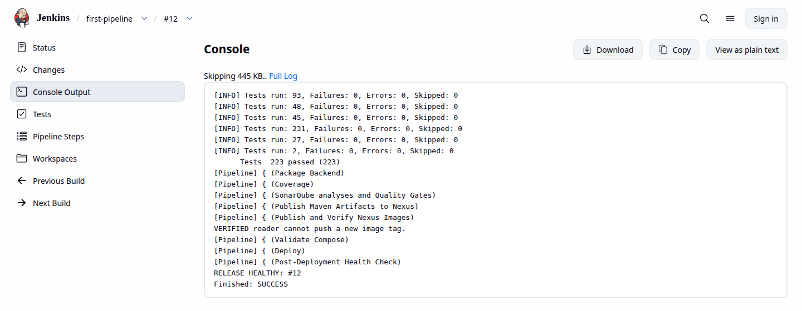
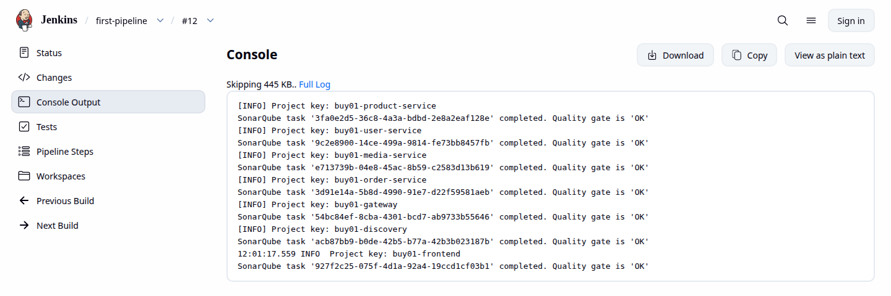
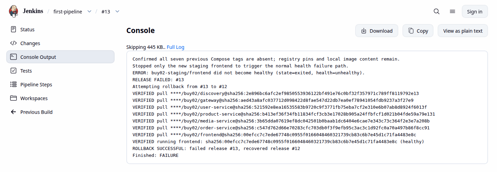

# Nexus/Maven completion report

The original Nexus/Maven cutover was verified on 2026-11-17 at localhost port
8081. The audit evidence below adds the local Jenkins validation from
2026-11-26. The remaining sections retain the original cutover results.

## Jenkins build 12 and rollback build 13

Jenkins `first-pipeline` build **#12** passed 446 backend tests, 223 frontend
tests, and all seven SonarQube Quality Gates. It published all six existing Maven
JAR/POM pairs and verified their SHA-256 checksums. It also published all seven
Docker images, verified them by digest, and deployed a healthy staging release.
Both audit builds used Jenkins Replay with the local working tree.

*Selected lines from the original build #12 console show the test results,
publishing stages and final `SUCCESS`.*

*The build #12 console records the project key and SonarQube's `OK` result for
each of the seven projects.*

Build **#13** deliberately stopped only the new staging frontend after deployment.
The test removed the seven previous local Compose tags while leaving image layers
and registry references in place. Jenkins read the release #12 manifest, pulled
all seven pinned images, restored their local tags, and verified the running
image IDs and health of the recovered deployment. Build #13 finished
`FAILURE`, and release #12 remained the last successful release.

*Selected lines from the original build #13 console show the stopped frontend,
the recovery pulls, and `ROLLBACK SUCCESSFUL` followed by `Finished: FAILURE`.*

See the [Maven publishing example](NEXUS_MAVEN_RUNBOOK.md#jenkins-maven-publishing)
and the [manifest and recovery commands](NEXUS_DOCKER_CI_RUNBOOK.md#7-roll-back-and-troubleshoot).

## Verified results

| Check | Result | Evidence |
| --- | --- | --- |
| Six full application builds/tests | PASS | Previous host-access clean verify: 446 tests, zero failures/errors/skips; Java, Spring Boot and POM versions preserved |
| Nexus tooling tests | PASS | 45 tests, including cache path/checksum/retry and SNAPSHOT inventory regressions |
| Compose validation | PASS | Existing and final localhost port configurations validated |
| Maven configuration audit | PASS | Six POM coordinates, deployment IDs and settings mirror checked |
| Administrator authentication/configuration | PASS | Four required Maven repositories, reader/publisher accounts, roles and anonymous-access restrictions verified |
| Existing SNAPSHOT inventory | PASS | All six found through repository-scoped Maven groupId/artifactId/baseVersion queries |
| Artifact downloads/checksums | PASS | JAR and POM bytes match hosted/group/local SHA-256 for all six |
| Maven version retrieval | PASS | All six 0.0.1-SNAPSHOT artifacts resolved through Nexus on final port 8081 after cutover |
| Proxy caching | PASS | Repeated group/proxy downloads match the stored maven-central asset's SHA-256 |
| Non-destructive RBAC | PASS | Reader/publisher downloads allowed; anonymous download, reader upload and publisher user administration denied; no DELETE requests |
| Runtime | PASS | Healthy, writable, non-root UID/GID 200, 127.0.0.1:8081 with buy02-nexus-data |
| Git secret/data scans | PASS | Current tracked content/path checks found no private credential files, archives, databases or secret signatures |
| Scoped diff whitespace | PASS | Nexus files and updated documentation pass |
| Entire worktree whitespace | FAIL | Pre-existing unrelated CRLF/trailing whitespace; those files were not modified by this cleanup |

## Published artifacts

All listed base versions are **0.0.1-SNAPSHOT** in **maven-snapshots**. Nexus
stores timestamped builds beneath these base versions. Latest checks only read
existing artifacts; nothing was republished or overwritten.

| Service | Maven coordinate |
| --- | --- |
| discovery | com.buy01:discovery:0.0.1-SNAPSHOT |
| gateway | com.buy01:gateway:0.0.1-SNAPSHOT |
| user-service | com.buy01:user-service:0.0.1-SNAPSHOT |
| product-service | com.buy01:product-service:0.0.1-SNAPSHOT |
| media-service | com.buy-01:media:0.0.1-SNAPSHOT |
| order-service | com.buy01:order-service:0.0.1-SNAPSHOT |

The cache verification failure was caused by comparing paths without accounting
for Nexus's leading slash. Verification now normalizes that slash, checks the
stored proxy asset SHA-256 and permits bounded retries (1, 2, 4 seconds).
Matching download bytes alone cannot pass. The helper's final inventory filter
now uses `maven.baseVersion`, which correctly finds timestamped SNAPSHOT builds.

## Responsibility handoff

- **Anas — completed:** Docker Compose deployment of Nexus, Maven repository
  provisioning, Maven publishing/retrieval/versioning, dependency proxy/cache,
  credentials and least-privilege RBAC, verification and Nexus documentation.
- **Ayoub — integration responsibility:** application Dockerfiles/images,
  Docker image publishing/retrieval and CI/CD integration. No application
  Dockerfiles or CI pipelines were modified by this cleanup.
- **Cutover completed:** only Nexus was recreated on localhost 8081. The same
  buy02-nexus-data volume and image are retained. Windows HTTP, readiness,
  writability, UID/GID 200, all six artifact checksums, caching and RBAC passed.

CI inputs: NEXUS_URL, NEXUS_READ_USERNAME, NEXUS_READ_PASSWORD,
NEXUS_PUBLISH_USERNAME and NEXUS_PUBLISH_PASSWORD. Administrator credentials
must never be supplied to Maven/CI. Remote CI needs an authenticated TLS endpoint
or SSH tunnel; do not broaden the localhost bind.

## Preserved data and deferred work

The native installation and `/var/lib/nexus` are preserved. The verified archive
`/var/backups/nexus/native-3.98.1-01-20261117T115025Z.tar` remains available;
recorded SHA-256:
`6e191d2ae6b34e798b0ecef0b5c9f3b4935ae1101e66a125802f0ffeb169dfdf`.
The approved Nexus container recreation and port mapping change were executed.
Read-only before/after hashes and metadata prove the complete native installation
and data are unchanged. The backup SHA-256 still matches the verified archive;
the native service remains inactive. Docker volume name, driver, mountpoint and
creation timestamp are unchanged. No artifacts, volumes or backups were deleted.
The private credential file is byte-for-byte unchanged; endpoint overrides are
in memory only. No credentials were reset.

Fresh Compose startup, private admin setup and idempotent provisioning were
verified in the separate onboarding instance on port 28081. Its end-to-end
publish test remains subject to operator EULA acceptance; it is distinct from
the fully verified migrated instance on 8081. The test volume is retained.

The Default Secret Encryption Key warning is deferred security work. Encryption
keys and secret storage were not changed. Full-worktree whitespace cleanup is
outside Anas's Nexus scope; stage only the reviewed Nexus changes. No automatic
commit, push or merge was performed.

See [NEXUS_MAVEN_RUNBOOK.md](NEXUS_MAVEN_RUNBOOK.md) for onboarding, backup,
rollback, CI endpoints and the completed cutover record.

## Post-cutover results

All requested post-cutover checks PASS, including actual Maven retrieval of all
six versions through port 8081. Windows HTTP returned 200, both status
and writable endpoints returned 200, and no blob-store read-only warnings were
found in the recreated container logs. Each service's JAR and POM SHA-256 matches
its hosted download, group download and local build. No artifacts were
republished. The existing unmanaged-volume Compose warning was informational;
identity checks confirm the original volume was reused rather than replaced.
There are no remaining cutover verification failures. The existing worktree
whitespace issues, Ayoub's CI/image integration and deferred encryption warning
remain separate from the completed deployment.
