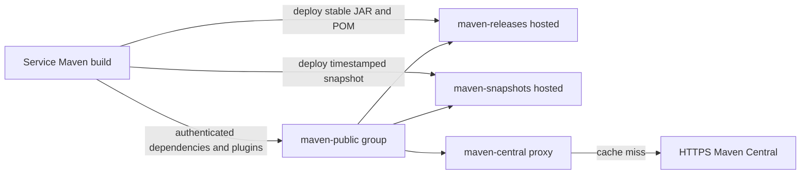

# buy-02 Nexus Maven implementation

## Recommended deployment: Sonatype Docker Compose

The recommended runtime is [`nexus/docker-compose.yml`](../nexus/docker-compose.yml),
using Sonatype's verified `sonatype/nexus3:3.98.1` image tag. The official image
metadata identifies this payload as Nexus 3.98.1-01, which matches the existing
native installation. It runs as the image's non-root UID 200 and expects
`/nexus-data` writable. Compose uses the named volume `buy02-nexus-data`, binds
`${NEXUS_HOST_PORT:-8081}` to `127.0.0.1`, restarts unless stopped, and checks
both Nexus read and write readiness. It has no published port on a non-loopback
interface. Sonatype documents UID 200 and recommends a Docker volume; see the
[official image documentation](https://github.com/sonatype/docker-nexus3#persistent-data)
and [verified image tags](https://hub.docker.com/r/sonatype/nexus3/tags).

The default tag is compatible by application version, but only a restored copy
can establish data compatibility. Do not attach `/var/lib/nexus` directly to a
container while the native service is running. Before migration, take a complete
offline archive of that directory, verify its file list and checksum, and keep
the native installation intact for rollback. The old WSL2 service currently
owns port 8081, so validation must use a temporary loopback port (18081), stop
the container, and then cut over to 8081. This document does not claim that
backup or cutover occurred unless a dated verification entry says so.

The native `nexus.properties` binds to `127.0.0.1`, which would bind only to the
container's private loopback after migration and make Docker port publishing
unreachable. The migration therefore changes only the copied volume's
`application-host` to `0.0.0.0`; Compose still publishes the host port solely on
`127.0.0.1`. The original file remains unchanged in `/var/lib/nexus` and in the
verified backup.

Compose validation and start for a fresh instance:

```bash
docker compose -f nexus/docker-compose.yml config --quiet
docker volume create buy02-nexus-data
docker compose -f nexus/docker-compose.yml up -d --wait
docker compose -f nexus/docker-compose.yml ps
curl --fail --show-error http://127.0.0.1:8081/service/rest/v1/status
curl --fail --show-error http://127.0.0.1:8081/service/rest/v1/status/writable
```

For migrated data, do not run the fresh-instance start above. First get explicit
operator approval for the privileged backup, native service stop, and copy into
the new named volume. Create the backup only after stopping Nexus so H2, blob
store and configuration files represent one consistent state. Verify the archive
before copying, populate a new volume while preserving file modes, then set
`/nexus-data` ownership to UID/GID 200 as required by the image. Never copy into
or start against the native directory itself. Start the container initially with
`NEXUS_HOST_PORT=18081`; after health, repository, user/role and blob-store
checks pass, stop that container before reusing the same volume on 8081. Keep the
offline archive and native installation for rollback. The exact commands must
be adjusted to the approved backup path and actual disk capacity; no privileged
copy is run by this guide automatically.

To stop the Compose deployment without deleting data:

```bash
docker compose -f nexus/docker-compose.yml stop
```

Do not use `down -v`, `volume rm`, or cleanup commands on `buy02-nexus-data`.
Back up a stopped container with a tar archive of `/nexus-data` and verify the
archive before storing it securely. Restore only into a separate/new volume with
Nexus stopped, preserving ownership and file modes; retain the previous volume
until restore checks complete.

### Authentication and Maven repositories

The data migration carries over the old admin password, repositories, users,
roles, blob stores and artifacts. The Compose file intentionally has no
bootstrap password setting that could replace migrated security state. Use the
existing `nexus/env.example` variable names with values from the private
credential store; never place secrets in Compose, Git, command history or chat.
The scripts provision `maven-releases`, `maven-snapshots`, `maven-central`, and
`maven-public`, plus separate reader and publisher roles. Use the runbook's
`provision`, `build all`, `publish all`, `verify-artifact`, `cache`, and
`verify-access` procedures after the Docker instance is healthy. Maven settings
are in `nexus/maven/settings.xml`; builds use reader credentials and publishing
uses publisher credentials. Existing artifacts are not to be overwritten.

### Migration status and verification

Read-only inspection on 2026-11-17 found Docker 29.7.1 / Compose 5.4.0 and no
existing Nexus container or `buy02-nexus-data` volume. Native Nexus 3.98.1-01
was active as `nexus:nexus` on `127.0.0.1:8081`; the operator stopped it and a
verified 3,521-entry archive was made. The archive still compares exactly with
the untouched 193 MiB native data directory. The restored copy has 3,469 files
and is owned by UID/GID 200:200. Temporary Docker Nexus 3.98.1-01 is healthy on
`127.0.0.1:18081`; UI/read/write checks and a Windows HTTP request return 200.
The default blob store has 3,373 files, is writable, and has no read-only
warnings. REST inventory of repositories/users/roles returns 401 because the
known private credentials are absent, so logical inventory and Maven checks
remain pending. Final port 8081 cutover has not been approved or run. See the
[dated completion report](NEXUS_COMPLETION_REPORT.md) for details. Keep the
native data and backup intact until cutover is approved.

#### Migration commands and execution boundary

The backup, restore into the new `buy02-nexus-data` volume, and temporary start
on loopback port 18081 have now been executed with operator approval. Their
results are recorded in `NEXUS_COMPLETION_REPORT.md`; do not rerun the first
section against the populated volume. It records the safe procedure for
reference. The final port change remains approval-gated.

```bash
set -euo pipefail
BACKUP="/var/backups/nexus/native-3.98.1-01-$(date -u +%Y%m%dT%H%M%SZ).tar"
sudo install -d -m 0700 /var/backups/nexus
sudo systemctl stop nexus.service
test "$(sudo systemctl show nexus.service --property=ActiveState --value)" = inactive
sudo test ! -e "$BACKUP"
sudo tar --create --file="$BACKUP" --numeric-owner --acls --xattrs \
  --directory /var/lib/nexus .
sudo tar --compare --file="$BACKUP" --directory /var/lib/nexus
sudo tar --list --file="$BACKUP" | wc -l
sudo sha256sum "$BACKUP" | sudo tee "$BACKUP.sha256" >/dev/null
sudo sha256sum --check "$BACKUP.sha256"

docker pull sonatype/nexus3:3.98.1
if docker volume inspect buy02-nexus-data >/dev/null 2>&1; then
  echo 'Refusing to overwrite existing buy02-nexus-data' >&2
  exit 1
fi
docker volume create buy02-nexus-data
BACKUP_NAME=$(basename "$BACKUP")
docker run --rm --network none --user 0:0 --entrypoint sh \
  --volume buy02-nexus-data:/dest \
  --volume /var/backups/nexus:/backup:ro \
  --env BACKUP_NAME="$BACKUP_NAME" mongo:7 -ec '
    test -z "$(ls -A /dest)"
    tar --numeric-owner --acls --xattrs -xpf "/backup/$BACKUP_NAME" -C /dest
    tar --compare --file="/backup/$BACKUP_NAME" --directory /dest
    grep -qxF application-host=127.0.0.1 /dest/etc/nexus.properties
    sed -i "s/^application-host=127\\.0\\.0\\.1$/application-host=0.0.0.0/" /dest/etc/nexus.properties
    chown -R 200:200 /dest
  '

NEXUS_HOST_PORT=18081 docker compose -f nexus/docker-compose.yml up -d --wait --wait-timeout 900
curl --fail --show-error http://127.0.0.1:18081/service/rest/v1/status
curl --fail --show-error http://127.0.0.1:18081/service/rest/v1/status/writable
docker exec buy02-nexus id
docker exec buy02-nexus sh -ec 'test -w /nexus-data/db && test -w /nexus-data/blobs/default'
```

Use the private admin/reader/publisher credentials to verify the migrated
repositories, accounts, roles, artifacts and Maven checksums before the final
port change. Those credentials are unavailable in the inspected environment;
do not reset the migrated admin password or guess credentials. Once the checks
pass and the operator approves cutover, move to port 8081 and prevent the
preserved native unit from competing after reboot:

```bash
NEXUS_HOST_PORT=18081 docker compose -f nexus/docker-compose.yml stop
docker compose -f nexus/docker-compose.yml up -d --wait --force-recreate
curl --fail --show-error http://127.0.0.1:8081/service/rest/v1/status
curl --fail --show-error http://127.0.0.1:8081/service/rest/v1/status/writable
sudo systemctl disable nexus.service
```

Rollback: stop the Compose service first, then run
`sudo systemctl enable --now nexus.service`. The original `/var/lib/nexus`,
backup archive and Docker volume remain separate. Never run both Nexus
instances against one writable directory, and never remove the backup or volume
as part of rollback.

This implements the Maven/Nexus portion of the existing marketplace. Application
Dockerfiles, container publishing, Docker repositories and CI pipelines remain
owned by the teammate. The actual verification results and outstanding checks are
in [NEXUS_VERIFICATION.md](NEXUS_VERIFICATION.md).

The [follow-up completion report](NEXUS_COMPLETION_REPORT.md) records the latest
repeated checks, installation approval boundary and exact private execution
steps. [NEXUS_SCRIPTS_EXPLAINED.md](NEXUS_SCRIPTS_EXPLAINED.md) explains every
script in Moroccan Darija. Java migration is deferred; the existing application
baseline is preserved as recorded in [JAVA11_COMPATIBILITY.md](JAVA11_COMPATIBILITY.md).

## Existing application and the Java 11 blocker

There is no root application `pom.xml`. There are six independent Spring Boot
projects and an Angular frontend. Preserve these existing Maven coordinates:

| Directory | groupId | artifactId | Current version | Packaging |
| --- | --- | --- | --- | --- |
| discovery | com.buy01 | discovery | 0.0.1-SNAPSHOT | executable JAR |
| gateway | com.buy01 | gateway | 0.0.1-SNAPSHOT | executable JAR |
| user-service | com.buy01 | user-service | 0.0.1-SNAPSHOT | executable JAR |
| product-service | com.buy01 | product-service | 0.0.1-SNAPSHOT | executable JAR |
| media-service | com.buy-01 | media | 0.0.1-SNAPSHOT | executable JAR |
| order-service | com.buy01 | order-service | 0.0.1-SNAPSHOT | executable JAR |

All POMs declare Java 17. Five use Spring Boot 4.1.0; media uses 4.1.1. They use
Spring Cloud 2025.1.2. Existing CI selects Java 21; the Maven compiler targets 17.
The wrappers request Maven 3.9.16. Existing dependency versions and JAR packaging
are preserved. The added `distributionManagement` blocks are the only application
POM changes made by this implementation.

**Java 11 is incompatible with this application.** Spring Boot 4.1 requires at
least Java 17. For example, `product-service/.../security/AuthenticatedUser.java`
is a Java record; order-service uses records, switch expressions, `Stream.toList()`
and Spring `RestClient`. A Java 11 migration needs coordinated application,
framework, servlet/security, Cloud and test changes, including a supported
dependency strategy. Setting `<java.version>11</java.version>` alone cannot fix
this. No dependency downgrade or application rewrite was made as part of Nexus
work. If evaluation strictly requires Java 11, this requirement remains unresolved
until the project baseline is reconciled. See the actual evidence in the
verification report and the [Spring requirements](https://docs.spring.io/spring-boot/4.1/system-requirements.html).

## Architecture and endpoints



With `NEXUS_URL=http://127.0.0.1:8081`:

| Purpose | Endpoint | Policy |
| --- | --- | --- |
| Web interface | http://127.0.0.1:8081/ | Localhost only |
| Release publishing | http://127.0.0.1:8081/repository/maven-releases/ | Maven hosted, RELEASE, ALLOW_ONCE |
| Snapshot publishing | http://127.0.0.1:8081/repository/maven-snapshots/ | Maven hosted, SNAPSHOT, ALLOW |
| Dependency proxy | http://127.0.0.1:8081/repository/maven-central/ | Maven proxy, RELEASE, STRICT |
| Maven resolution | http://127.0.0.1:8081/repository/maven-public/ | Group includes all three above |
| Read readiness | http://127.0.0.1:8081/service/rest/v1/status | HTTP 200 when ready |
| Write readiness | http://127.0.0.1:8081/service/rest/v1/status/writable | HTTP 200 when writable |
| Server API schema | http://127.0.0.1:8081/service/rest/swagger.json | Check the installed version's API |

The proxy remote is `https://repo.maven.apache.org/maven2/`. All repositories
use the persistent `default` blob store. Repository settings live in
`nexus/repositories.json`; URLs follow `NEXUS_URL`, including a reverse proxy
context path if needed. Omit the trailing slash from `NEXUS_URL`.

## Prerequisites and native installation

Use a Linux x86-64 host with systemd and administrator privileges. It needs Bash,
curl, GNU tar/coreutils, Python 3.9+, util-linux (`flock`), account-management tools,
outbound HTTPS and persistent local disk. Allow adequate RAM for the vendor JVM
defaults, direct memory and the OS; size the host using the
[Nexus requirements](https://help.sonatype.com/en/sonatype-nexus-repository-system-requirements.html).
Do not place Nexus data on the Windows/OneDrive checkout filesystem.

The installer pins **Nexus 3.98.1-01**, verified against the official download page
on 2026-11-16, with a pinned official SHA-256. Sonatype now calls the current free
binary **Community Edition**, the successor to the older OSS distribution. It is
not accurate to label the current binary as the old OSS edition. Review its
license/Community Edition setup and telemetry requirements in the initial wizard.
The installer uses the bundled Java 21 runtime; it does not change application
Java or the host's default JDK. Sources: [download](https://help.sonatype.com/en/download.html),
[edition information](https://www.sonatype.com/products/nexus-community-edition-download),
[runtime requirements](https://help.sonatype.com/en/upgrade-nexus-repository-java-version.html).

On the intended Nexus host, from the repository root:

```bash
bash -n nexus/install.sh nexus/download.sh nexus/healthcheck.sh
sudo bash nexus/install.sh
sudo systemctl status nexus --no-pager
sudo systemctl list-timers nexus-healthcheck.timer
bash nexus/healthcheck.sh
```

Expected after a successful installation: service `active (running)` and
`Nexus is ready for reads and writes.` These are expected outputs, not a claim
that installation ran in the development sandbox.

The installer is for a **fresh instance**. It refuses existing unmanaged
installation/data paths and checks the archive before extraction. Repeating a
completed managed installation enables the service and rechecks readiness;
it does not reinstall software or erase data. Partial-installation failures
require reviewing the existing paths and service logs before retrying. Do not
delete an existing data directory to get past the guard.

### Recovering an interrupted download

The pinned URL is
`https://download.sonatype.com/nexus/3/nexus-3.98.1-01-linux-x86_64.tar.gz`.
The trusted SHA-256 remains
`a8b204c50708729492380697c1d64f342281468ddfd96e1ab199de86a478e768`.

The installer calls `nexus/download.sh`, which retains downloads on Linux disk:

```text
/var/cache/nexus/downloads/nexus-3.98.1-01-linux-x86_64.tar.gz.part
/var/cache/nexus/downloads/nexus-3.98.1-01-linux-x86_64.tar.gz.source
/var/cache/nexus/downloads/nexus-3.98.1-01-linux-x86_64.tar.gz
```

`.source` binds a partial to the expected URL/checksum. The final filename is
available only after full checksum verification. The helper never extracts
anything, and the installer checks the checksum again immediately before tar.
A verified cached archive is reused without replacing it or fetching it again.

Five fresh curl invocations use `--continue-at -` to recalculate the latest byte
offset after each failure, including curl exit 56. Backoff is 2, 4, 8 and 16
seconds. Each attempt has a 20-second connection timeout, 1800-second maximum,
and a low-speed timeout below 1024 bytes/second for 60 seconds. TLS verification
stays enabled; both the URL and redirects must use HTTPS. Curl's internal retry
counter is intentionally zero because the outer loop resumes from each new
on-disk offset. No `--remove-on-error` option is used.

If a server ignores/refuses resume (curl 33 or HTTP 416), only that incomplete
cache candidate is moved to a unique `.rejected.*` name and a fresh transfer is
attempted. A bad completed checksum can trigger one fresh transfer; persistent
mismatch aborts. Rejected candidates are preserved for inspection, never
extracted. All retries are bounded. A server without Range support must complete
a fresh transfer; the client cannot make it resumable.

After an interrupted transfer, approve and run the same installer command in a
private local terminal. **No sudo is executed by the assistant without approval.**

```bash
sudo bash nexus/install.sh
```

The former installer downloaded into a `mktemp` directory and its EXIT trap
deleted that directory on curl failure. A partial already deleted by that trap
cannot be recovered. If a copy survived elsewhere, explicitly import it:

```bash
# Replace the absolute path with an existing regular file; original is preserved.
sudo env NEXUS_PARTIAL_ARCHIVE=/absolute/path/nexus-3.98.1-01-linux-x86_64.tar.gz \
  bash nexus/install.sh
```

The script copies that candidate into the cache only if no bound partial already
exists, then verifies the completed bytes against the same pinned hash. It does
not trust a candidate merely because its name or size looks correct.

The extraction directory is still temporary; cleanup removes only that scratch
directory. Nexus data and downloaded bytes survive errors. Download-stage reruns
resume automatically. A failure after application/data paths have been created
still requires inspection if the managed-install marker was not completed; the
installer refuses to overwrite those paths. Do not delete Nexus data to retry.
An existing completed managed installation takes the existing readiness path
without downloading or reinstalling binaries. The nexus account is now created
only after verified download, extraction and bundle-layout checks.

Non-root regression checks (curl, OpenSSL and local socket access required):

```bash
bash -n nexus/install.sh nexus/download.sh nexus/healthcheck.sh
python3 -m unittest discover -s scripts/nexus -p 'test_*.py' -v
```

There are 50 tests: the original 29 Nexus tooling tests, one access-probe
safety regression test, and 20 real curl/TLS download regression tests. These fixtures do not download or install the real
Nexus distribution. After actual installation, run `bash nexus/healthcheck.sh`
and inspect `systemctl show nexus.service -p User -p MainPID -p ActiveState`,
then `ps -u nexus -o user,pid,args` to verify that the Nexus JVM really runs as nexus.

### Files, ownership and restart behavior

| Installed path | Owner/purpose |
| --- | --- |
| /opt/nexus-3.98.1-01 | root:nexus, application and bundled runtime, no group/world write |
| /opt/nexus | Symlink to the pinned release |
| /var/lib/nexus | nexus:nexus, 0750, persistent database, blobs, configuration and logs |
| /var/lib/nexus/etc/nexus.properties | 0640, localhost listener and scripting restrictions |
| /usr/local/libexec/nexus-healthcheck | root-owned readiness script |
| /etc/systemd/system/nexus*.service | root-owned 0644 systemd definitions |

The service runs as the dedicated non-login `nexus` user with `UMask=0027`.
Application files are read-only to the service; persistent state is writable.
`nexus run` stays in the foreground for systemd process tracking. Startup waits
for read/write readiness, crashes trigger a restart, and the timer checks health
each minute after boot. Failed timer checks appear as failed healthcheck units;
the timer does not restart a live but unhealthy process automatically. Monitor
those failures. No automatic garbage collection or artifact deletion is enabled.

```bash
sudo systemctl restart nexus
sudo systemctl status nexus-healthcheck.service --no-pager
sudo journalctl -u nexus -n 80 --no-pager
sudo tail -n 80 /var/lib/nexus/log/nexus.log
sudo ss -ltnp 'sport = :8081'
ps -eo user,pid,comm | rg 'nexus|java'
sudo stat -c '%U:%G %a %n' /var/lib/nexus /var/lib/nexus/etc/nexus.properties
```

Expected listener: `127.0.0.1:8081`; the Nexus JVM user must be `nexus`, never root.
For backups, stop Nexus and back up **all** of `/var/lib/nexus` consistently,
including H2, blob storage and preferences; restore onto a compatible release
with the same ownership. Store backups privately and test restoration separately.
The installer does not perform upgrades or database migrations.

### Blob store incorrectly read-only under systemd (WSL2 incident)

Nexus 3.98.1-01 reported `File blob store 'default' is not writable. Read only:
true.` despite correct nexus:nexus ownership, 0750 directories and ample disk.
The operator's read-only diagnostic found `Files.isWritable=true` inside and
outside the service, but `FileStore.isReadOnly=true` only inside it. The root
mount was read-only there, with `/var/lib/nexus` a writable same-device bind
mount. This is a mount-detection problem; changing blob permissions is not the fix.

[OpenJDK's LinuxFileStore implementation](https://raw.githubusercontent.com/openjdk/jdk21u/master/src/java.base/linux/classes/sun/nio/fs/LinuxFileStore.java)
walks parent directories using filesystem device IDs to select a mount entry.
A bind mount on the same device can lead it to select `/`. The existing
`ProtectSystem=strict` makes that mount read-only. Another same-device bind mount
or another `ReadWritePaths` entry does not resolve that distinction. Moving the
data to a different filesystem would be substantially more invasive.

The repository's service template now uses:

```ini
ProtectSystem=full
ReadOnlyPaths=/opt /var /mnt /media /srv /run
ReadWritePaths=/var/lib/nexus
```

According to [systemd's filesystem protection documentation](https://www.freedesktop.org/software/systemd/man/latest/systemd.exec.html#ProtectSystem=),
`full` keeps `/usr`, `/boot`, `/efi` and `/etc` read-only. The explicit list
retains protection for application files, other state directories and Windows
mounts. The nested data write exception and existing `ProtectHome=true`,
`PrivateTmp=true`, `NoNewPrivileges=true`, `UMask=0027` and non-root account remain.
Root is writable at mount level but is not writable by nexus through ordinary
permissions. This is not identical to `strict`: additional top-level directories
need review and potentially explicit protection when created.

**Current incident status: operator installed the approved override and restarted
Nexus. The effective namespace and absence of warnings were verified; the Java
probe output and authenticated artifact write/read are still pending.**
The installer copies the template only on fresh installation. Its existing-install
shortcut does not deploy template updates. Do not reinstall or delete data to
apply this fix. Use a small systemd drop-in after reviewing and approving it.

The prepared `/tmp/nexus-blobstore-fix/10-filestore.conf` contains exactly:

```ini
[Service]
# Keep Java FileStore detection compatible with the writable data bind mount.
ProtectSystem=full
ReadOnlyPaths=/opt /var /mnt /media /srv /run
```

It inherits `ReadWritePaths=/var/lib/nexus` from the installed unit. Verify the
file's contents and ensure no existing override conflicts before proceeding.
Only after explicit approval, from a private local terminal:

```bash
sudo install -D -o root -g root -m 0644 /tmp/nexus-blobstore-fix/10-filestore.conf /etc/systemd/system/nexus.service.d/10-filestore.conf
sudo systemctl daemon-reload
sudo systemctl restart nexus.service
```

These commands create the override, reload systemd and restart Nexus. A restart
is necessary because the running process retains its old mount namespace.
No permissions, application runtime, repositories or data are migrated. The `/tmp`
source is temporary; if missing, recreate it with the exact contents above and
review it before use. The service's ExecStartPost waits for HTTP readiness.

After approval, repeat the already reviewed diagnostic:

```bash
sudo bash /tmp/nexus-blobstore-diagnosis/inspect.sh
systemctl show nexus.service -p User -p Group -p MainPID -p ActiveState -p ProtectSystem -p ReadOnlyPaths -p ReadWritePaths
bash nexus/healthcheck.sh
ps -u nexus -o user,group,pid,comm
ss -ltn 'sport = :8081'
invocation=$(systemctl show nexus.service -p InvocationID --value)
journalctl --no-pager -o cat "_SYSTEMD_INVOCATION_ID=$invocation"
```

Require both probe environments to report `FileStore.isReadOnly=false` and
`Files.isWritable=true`. The diagnostic is the previously reviewed temporary
script, not part of the installer; do not execute an unknown replacement.
Using its dynamically obtained MainPID, inspect the service namespace mounts
with `findmnt -N PID -T /opt`, `findmnt -N PID -T /var` and
`findmnt -N PID -T /var/lib/nexus`: expect ro, ro and rw respectively.
Require the process owner nexus, an active service and localhost-only 8081.
Observe logs for at least 60 seconds after readiness and recheck the current
invocation for the warning; old invocation warnings do not indicate a new failure.

Both readiness endpoints returned HTTP 200 during this incident while the blob
store was still classified read-only. A real upload and checksum-verified download
are therefore needed, using privately supplied reader/publisher credentials:

```bash
export NEXUS_URL=http://127.0.0.1:8081
python3 scripts/nexus/manage.py publish gateway
python3 scripts/nexus/manage.py verify-artifact gateway --local
```

The current gateway version is `0.0.1-SNAPSHOT`; the publish workflow runs Maven
tests and deploys to the snapshot repository, then verifies retrieval. No POM
change or release overwrite is required. See the credential setup and publishing
sections below; never use administrator credentials in Maven. If the repair
fails, stop and inspect the service error before making another change. Reverting
only this override and restarting restores the previous namespace and its known
blob-store problem; rollback also needs approval, not a reinstall.

### First administrator login and remote access

Read `/var/lib/nexus/admin.password` locally on the host using administrator
access. Do not put its contents in Git, shared terminal recordings or screenshots.
Open the web interface, sign in as `admin`, change the generated password, finish
the edition/license setup, and **disable anonymous access** in the setup wizard.
Use the changed administrator password for provisioning. The scripts do not
automatically change or store the administrator password.

For remote administration, keep Nexus bound to localhost and tunnel:

```bash
ssh -N -L 8081:127.0.0.1:8081 operator@nexus-host
```

Then use `http://127.0.0.1:8081` on the workstation. Shared remote builders need
a private HTTPS reverse proxy with a trusted certificate, authentication retained,
restricted firewall access and an upload size/timeout suitable for service JARs.
Provision that infrastructure before changing the access model. Do not use a
public ngrok tunnel or open port 8081 to the Internet. The Python client rejects
remote cleartext URLs and credentialed redirects.

## Private environment and repository/RBAC provisioning

`nexus/env.example` lists variable names without real credentials. Use a private
terminal or a secret manager. For example:

```bash
export NEXUS_URL=http://127.0.0.1:8081
export NEXUS_ADMIN_USERNAME=admin
export NEXUS_READ_USERNAME=buy02-reader
export NEXUS_PUBLISH_USERNAME=buy02-publisher
export NEXUS_READ_EMAIL=reader@example.org       # replace with an appropriate address
export NEXUS_PUBLISH_EMAIL=publisher@example.org # replace with an appropriate address
read -rsp 'Changed Nexus administrator password: ' NEXUS_ADMIN_PASSWORD; echo
export NEXUS_ADMIN_PASSWORD
read -rsp 'Choose a reader password (16+ characters): ' NEXUS_READ_PASSWORD; echo
export NEXUS_READ_PASSWORD
read -rsp 'Choose a publisher password (16+ characters): ' NEXUS_PUBLISH_PASSWORD; echo
export NEXUS_PUBLISH_PASSWORD

python3 scripts/nexus/manage.py provision
python3 scripts/nexus/manage.py provision --apply
python3 scripts/nexus/manage.py verify-config
```

The first command displays a plan without writing. The second reconciles the
repositories and roles, creates missing accounts, disables anonymous access and
reads back configuration. It uses supported `/service/rest/v1` REST APIs, not
server-side Groovy or direct database writes. Inspect the server Swagger schema
if a future Nexus version changes API fields. See
[repositories API](https://help.sonatype.com/en/repositories-api.html) and
[security API](https://help.sonatype.com/en/security-management-api.html).

Existing Maven repositories are updated in place. Name/type collisions stop
before writes. Unrelated repository settings and extra group members are retained.
A different existing blob store requires an explicit configuration review rather
than automatic storage migration. Other repository formats are untouched.
Configuration is not transactional: if an API write fails, fix the error and rerun;
do not delete and recreate repositories. Repeat provisioning should produce no
repository/role/account writes once configuration matches.

Existing accounts must already have exactly the expected project role and active
status. Unexpected roles stop provisioning rather than taking over the account.
Existing passwords are never reset. Supplied environment passwords must match
them; `verify-access` checks actual logins. New service accounts require distinct
usernames, email addresses and passwords of at least 16 characters.

| Account/role | Allowed | Excluded |
| --- | --- | --- |
| admin | Initial setup, repositories, users, policies | Never supplied to Maven/CI |
| buy02-maven-reader | browse/read on maven-public | Direct proxy/hosted access, writes, deletion, admin |
| buy02-maven-publisher | reader role plus browse/read/add/edit on maven-releases and maven-snapshots | Deletion, proxy/group publishing, user/repository administration |

Maven deploy uses HTTP PUT and updates repository metadata, so the publisher needs
both add/edit content privileges. `ALLOW_ONCE` protects release asset paths even
with edit privileges. Release metadata can still list additional versions.
Roles contain no wildcards or administrator inheritance. Nexus privileges are
additive, which is why unexpected extra account roles are rejected. See
[privileges](https://help.sonatype.com/en/privileges.html).

Anonymous access is disabled **globally**. Tell the teammate that Docker clients
must also authenticate; this script does not alter Docker repositories or realms.
Keep credentials in a password manager or protected external environment file
(directory 0700, file 0600). The `.gitignore` under `nexus/` excludes private
`secrets/`, `.env`, `*.password`, downloaded data and `settings.local.xml`.
Do not run `set -x`, Maven `-X`, or publish effective settings in shared logs.

## Maven settings and builds

Use the tracked example directly; it contains only `${env...}` placeholders.
No global Maven configuration change is necessary:

```bash
python3 scripts/nexus/manage.py audit
python3 scripts/nexus/manage.py build all
```

The default helper uses each existing Maven wrapper. For an installed Maven:

```bash
export JAVA_HOME=/usr/lib/jvm/java-21-openjdk-amd64 # use the JDK path on your machine
export MAVEN_BIN=/usr/bin/mvn
export NEXUS_MAVEN_CACHE=/tmp/buy02-nexus-maven-cache # optional dedicated cache
python3 scripts/nexus/manage.py build gateway
```

Equivalent direct command from a service directory:

```bash
cd gateway
bash ./mvnw -B -ntp -s ../nexus/maven/settings.xml clean verify
```

The mirror ID `nexus-public` matches the reader credential server ID. `mirrorOf=*`
routes dependency **and plugin** repositories through the group. An active profile
enables snapshot dependencies; Maven Central's default snapshot-disabled policy
alone would not resolve hosted snapshots. Deployment IDs `nexus-releases` and
`nexus-snapshots` match the two publishing credential server IDs in settings.xml.
Repositories and server IDs serve different purposes and may have different names.

If a personal copy is required, preserve the existing `~/.m2/settings.xml`:

```bash
install -d -m 0700 "$HOME/.m2"
install -m 0600 nexus/maven/settings.xml "$HOME/.m2/buy02-nexus-settings.xml"
# Explicit -s keeps all other projects' Maven settings unchanged.
mvn -B -s "$HOME/.m2/buy02-nexus-settings.xml" -f gateway/pom.xml validate
```

Use normal baseline builds while Nexus is unavailable:

```bash
python3 scripts/nexus/manage.py build all --direct
```

This baseline command does not demonstrate Nexus routing. Order-service's full
suite requires a working Docker daemon for MongoDB Testcontainers. Do not bypass
those tests when publishing. For HTTPS with a private CA, `NEXUS_CA_BUNDLE` configures
Python trust only. Configure the selected JDK's trust store separately for Maven;
do not disable certificate validation in either client.

## Publishing and checking artifacts

On a configured instance, remove administrator credentials from the build shell:

```bash
unset NEXUS_ADMIN_USERNAME NEXUS_ADMIN_PASSWORD
python3 scripts/nexus/manage.py publish gateway
python3 scripts/nexus/manage.py verify-artifact gateway --local
# Publish every existing Java service, stopping at the first failed build/upload:
python3 scripts/nexus/manage.py publish all
```

`publish` runs `clean deploy`. Maven executes tests, packaging and the verify phase
before deployment. Existing test failures abort publication. The repository is
selected by the POM version: `*-SNAPSHOT` goes to maven-snapshots; stable versions
go to maven-releases. There is no `skipTests` publishing option in the helper.
If a stable version's POM already exists, the helper refuses redeployment; Nexus's
immutable policy also protects against races and partially uploaded releases.
If any asset already exists from a partial release upload, use a new stable version.

After Maven deploy, the helper downloads both JAR and POM from the hosted repository
and the group and compares SHA-256 values to each other and to the local build.
Snapshots use the server's `maven-metadata.xml` timestamp/build number. It reports
`CONFIRMED available: com.buy01:gateway:...` only after these checks succeed.
If deployment happened but verification fails, treat publication as **unconfirmed**
and investigate; a failed check does not roll back uploaded artifacts.

Equivalent commands, when using an existing Maven installation:

```bash
mvn -B -ntp -s nexus/maven/settings.xml -f gateway/pom.xml clean verify
mvn -B -ntp -s nexus/maven/settings.xml -f gateway/pom.xml deploy
python3 scripts/nexus/manage.py verify-artifact gateway --local
```

The separate `deploy` command repeats the lifecycle tests. This is deliberate;
the single `clean deploy` helper avoids doing the lifecycle twice.

Download a stable JAR using curl's interactive password prompt (no password in argv):

```bash
curl --fail --show-error --user "$NEXUS_READ_USERNAME" \
  "$NEXUS_URL/repository/maven-public/com/buy01/gateway/1.0.0/gateway-1.0.0.jar" \
  --output /tmp/gateway-1.0.0.jar
sha256sum /tmp/gateway-1.0.0.jar
python3 scripts/nexus/manage.py resolve gateway --version 1.0.0
```

For snapshots, `verify-artifact gateway --version 1.0.0-SNAPSHOT` prints the exact
timestamped download URL. The `resolve` helper handles metadata automatically.
These are executable Spring Boot applications, not ordinary shared-library JARs;
the retrieval example uses `-Dtransitive=false` to fetch the selected application.

## Dependency proxy and caching demonstration

Use an isolated Maven cache so an already-downloaded local dependency cannot hide
whether Maven contacted Nexus. Keep the Nexus instance running and configured:

```bash
export NEXUS_MAVEN_CACHE=$(mktemp -d /tmp/buy02-maven-first.XXXXXX)
python3 scripts/nexus/manage.py resolve gateway --version 1.0.0
# Maven logs should show downloads from nexus-public, never direct Maven Central.
export NEXUS_MAVEN_CACHE=$(mktemp -d /tmp/buy02-maven-second.XXXXXX)
python3 scripts/nexus/manage.py resolve gateway --version 1.0.0
# Each Maven cache is new; Nexus keeps its persistent storage across both runs.
```

The dependency plugin and its dependencies exercise Central proxy resolution.
The requested gateway JAR itself exercises hosted group resolution. For a direct
public dependency example:

```bash
mvn -B -ntp -s nexus/maven/settings.xml -f gateway/pom.xml \
  -Dmaven.repo.local="$NEXUS_MAVEN_CACHE" \
  org.apache.maven.plugins:maven-dependency-plugin:3.8.1:get \
  -Dartifact=org.apache.commons:commons-lang3:3.17.0:jar -Dtransitive=false
```

For server-side cache evidence, load administrator environment variables in a
separate private administration shell, then:

```bash
python3 scripts/nexus/manage.py cache
sudo tail -n 80 /var/lib/nexus/log/request.log
```

The command downloads commons-lang3 twice through the group without any local
Maven cache, checks the direct proxy bytes and the stored proxy asset through
`search/assets`. It records whether the asset was already indexed before the
request; it does not claim a first cache miss if the asset was preloaded. Nexus
search indexing is asynchronous: retry if it reports that the asset is not indexed
yet. Expected success includes `VERIFIED repeated group downloads and stored
maven-central asset`. Incoming request logs demonstrate requests reached Nexus;
they do not alone prove there was no upstream request.

To demonstrate serving cached artifacts without upstream access during a planned
lab test: after a successful fetch, an administrator can temporarily enable
**Block outbound connections on the repository** for maven-central in the Nexus
UI (do not take the repository offline). Fetch the same public JAR with curl
through maven-public and compare its SHA-256. Restore the setting immediately in
the UI. This affects every consumer of that proxy; schedule it with the teammate.
Do not run a full new Maven build in that state unless all plugin artifacts are
also cached. Do not remove live Nexus cache files by hand.

Proxy policy caches release content indefinitely (`contentMaxAge=-1`), refreshes
metadata after 1440 minutes and negative lookups after 15 minutes. A cached 404
may require invalidating the affected proxy cache through the UI or waiting for
the TTL after a new upstream artifact appears. `mvn -U` refreshes Maven's local
checks but does not bypass every Nexus cache policy.

## Version workflow and previous versions

The current `0.0.1-SNAPSHOT` is retained until you explicitly choose a version.
The helper accepts `major.minor.patch` with optional `-SNAPSHOT`; no dynamic
`LATEST`/`RELEASE` values. Each service can evolve independently.

```bash
python3 scripts/nexus/manage.py set-version gateway 1.0.0-SNAPSHOT
git diff -- gateway/pom.xml
python3 scripts/nexus/manage.py publish gateway
python3 scripts/nexus/manage.py resolve gateway --version 1.0.0-SNAPSHOT

python3 scripts/nexus/manage.py set-version gateway 1.0.0
python3 scripts/nexus/manage.py publish gateway
python3 scripts/nexus/manage.py set-version gateway 1.0.1
python3 scripts/nexus/manage.py publish gateway

python3 scripts/nexus/manage.py verify-artifact gateway --version 1.0.0
python3 scripts/nexus/manage.py verify-artifact gateway --version 1.0.1
python3 scripts/nexus/manage.py resolve gateway --version 1.0.0

# Start the next development cycle after publishing the stable release.
python3 scripts/nexus/manage.py set-version gateway 1.0.2-SNAPSHOT
```

These actions publish real versions when executed against a live server; they
have not been pre-executed against an imaginary instance. `set-version` invokes
the pinned Maven versions plugin and does not change the Spring Boot parent or
dependency versions. Review the POM diff and run tests for every chosen version.
Use `set-version all ...` only if intentionally versioning every service together.
No Git commits or tags are created automatically.

Published stable versions remain available by exact coordinates, so selecting
`1.0.0` retrieves that older artifact even after `1.0.1` is released. A snapshot
coordinate resolves the newest timestamped build; use its exact timestamped URL
from metadata to identify a particular snapshot build. Multiple snapshots at a
base version are allowed; stable release assets cannot be overwritten.

## Verification and troubleshooting

```bash
python3 scripts/nexus/manage.py audit
python3 -m unittest discover -s scripts/nexus -p 'test_*.py' -v
bash -n nexus/install.sh nexus/healthcheck.sh
python3 scripts/nexus/manage.py verify-config   # administration shell
python3 scripts/nexus/manage.py cache           # administration + reader credentials
python3 scripts/nexus/manage.py verify-access  # reader and publisher credentials
python3 scripts/nexus/manage.py build all
python3 scripts/nexus/manage.py verify-artifact gateway --local
```

`verify-access` confirms authenticated group reads and denies anonymous reads,
reader publishing and publisher user administration. The reader's denied PUT
targets a fresh `nexus-access-probe-<uuid>` snapshot POM for each run. It does
not reuse an earlier probe or issue any DELETE request. If the reader is
misconfigured and the PUT succeeds, verification fails and leaves that new probe
for administrator review. `verify-config` separately checks that the live roles
contain no delete privileges; this is configuration evidence, not a runtime
DELETE-denial test. Never remove stored artifacts automatically during verification.
Positive upload rights require successful snapshot **and** release publications.
Review service non-root execution and filesystem permissions separately on the host.

| Failure | Action |
| --- | --- |
| Java 11 requested | Read the baseline conflict above; a compiler-property edit cannot migrate Boot 4.1 |
| Installer refuses systemd/root | Run it with sudo on the designated systemd Linux host |
| SHA-256 mismatch | Stop; verify the official version/checksum and download source |
| Service not ready | Inspect systemd and Nexus logs, memory, free disk and data permissions |
| HTTP 401 | Check the matching account password and complete the first-login wizard |
| HTTP 403 | Check the exact repository role; never grant admin as a publishing fix |
| HTTP 400/409 on release deploy | Check version policy and existing assets; use a fresh immutable version |
| HTTP 404 | Check coordinate paths, group members, version and negative cache TTL |
| TLS errors | Trust the correct CA in Python and the selected JDK; retain certificate validation |
| Maven still contacts Central | Check the explicit `-s` path, mirror `*`, and inherited/user settings |
| Unresolved `${env.NEXUS_URL}` | Export the variable before Maven runs; use no trailing slash |
| Testcontainers failure | Make the real Docker daemon and required image available; do not skip tests for publication |
| Upload succeeds, verification fails | Inspect actual Nexus assets and timestamp metadata; do not claim publication confirmed |
| Proxy search empty after fetch | Wait for indexing, retry, and inspect request logs |
| Existing account differs | Review roles/status manually instead of overwriting a shared account |

## Teammate integration contract

No Dockerfile, Docker repository, Jenkinsfile, pipeline trigger or CI secret was
implemented or modified. Supply the teammate with:

1. A reachable **private HTTPS** `NEXUS_URL` (or a host-local tunnel in a lab).
   `127.0.0.1` inside a CI container refers to that container, not the Nexus host.
2. Group URL `${NEXUS_URL}/repository/maven-public/`, release URL
   `${NEXUS_URL}/repository/maven-releases/`, snapshot URL
   `${NEXUS_URL}/repository/maven-snapshots/` and the settings example path.
3. Secret bindings `NEXUS_READ_USERNAME`, `NEXUS_READ_PASSWORD`,
   `NEXUS_PUBLISH_USERNAME`, `NEXUS_PUBLISH_PASSWORD`. Never bind admin credentials
   to CI. Passwords/tokens remain in their CI secret store.
4. Java 21 for the current project (compiler target 17), Bash/Python, existing
   wrappers, Docker access for the full order-service test suite, outbound access
   for the Maven wrapper distribution and trusted HTTPS certificates.
5. `python3 scripts/nexus/manage.py publish all`, or per-service `clean deploy`
   with `-s nexus/maven/settings.xml`, followed by artifact verification.
6. The globally disabled anonymous policy and the unresolved Java 11 requirement.

The teammate decides how to integrate these commands and secrets into their
pipeline. Maven publishing is independent of their Docker image publishing.

## Screenshot checklist for evaluation

Capture these **only after real execution**. Hide passwords, tokens and sensitive
hostnames. No screenshots were fabricated for this implementation.

- Running service and non-root Nexus process; localhost listener and persistent directory ownership.
- Repository list showing the two hosted repositories, proxy and group.
- Release `ALLOW_ONCE`, snapshot policy, Central remote URL and group membership.
- Reader and publisher roles with the exact privileges; no admin role on service accounts.
- Anonymous access disabled and an actual rejected anonymous artifact request.
- Maven build log showing tests and downloads from `nexus-public`.
- Successful release and snapshot publishes, server assets, timestamped snapshot metadata and matching download hashes.
- Two stable versions available side by side and retrieval of the older version.
- Stored maven-central proxy asset and request log entries for repeated fetches.
- Real verification results, including any remaining failed/unverified checks.
