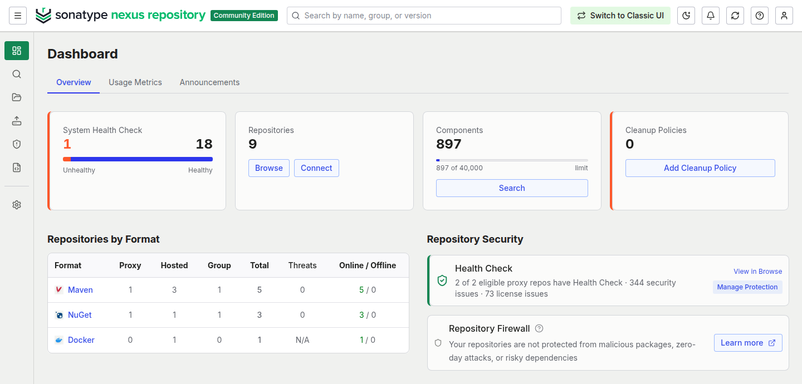
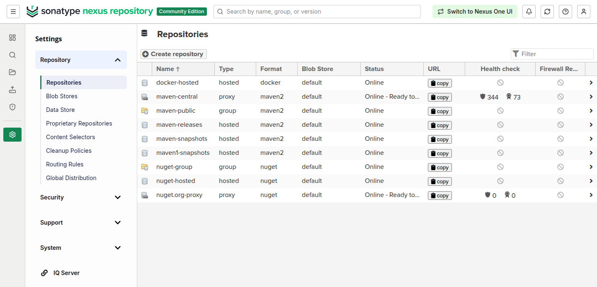
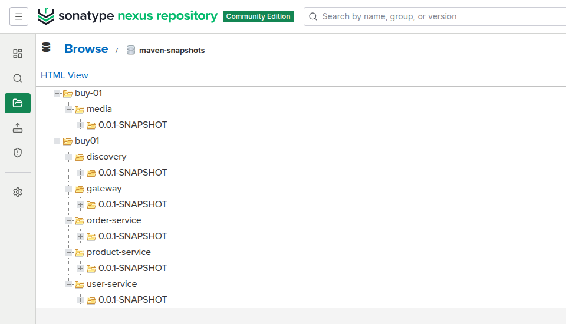

# Nexus and Maven runbook

Docker Compose is the supported Nexus deployment. Native WSL/systemd files have
been removed from this checkout; the existing native installation and backup
remain intact on the host as a rollback option.

## Current verified state

- Sonatype `sonatype/nexus3:3.98.1` provides Nexus `3.98.1-01`.
- `buy02-nexus-data` is the persistent Docker volume; the container uses UID/GID
  200 and the host port is restricted to `127.0.0.1`.
- The final instance is healthy on `http://127.0.0.1:8081`. HTTP health,
  write-readiness and Windows browser checks returned 200. The verified backup
  and original `/var/lib/nexus` are preserved.
- Authenticated provisioning, all six SNAPSHOT publications, downloads/checksums,
  Maven retrieval, caching and RBAC checks passed. The approved final port 8081
  cutover also passed every requested check. See the completion report.

## Start, stop and inspect



*The local Nexus dashboard loaded and reported five Maven repositories and one
Docker repository online. The separate system-health card shows one unhealthy
check, so this capture is evidence of availability.*

Use the existing restored volume. Do not create an empty volume or restore over
the live volume. From the repository root:

```bash
docker compose -f nexus/docker-compose.yml config --quiet
NEXUS_HOST_PORT=8081 docker compose -f nexus/docker-compose.yml up -d --wait --wait-timeout 900
docker compose -f nexus/docker-compose.yml ps
docker inspect buy02-nexus --format '{{.State.Health.Status}}'
docker exec buy02-nexus id
curl --fail http://127.0.0.1:8081/service/rest/v1/status
curl --fail http://127.0.0.1:8081/service/rest/v1/status/writable
docker compose -f nexus/docker-compose.yml logs --tail=100 nexus
docker compose -f nexus/docker-compose.yml stop
docker compose -f nexus/docker-compose.yml start
```

The Compose default is host port 8081; `NEXUS_HOST_PORT` overrides only the
localhost-published port. Never bind Nexus to `0.0.0.0`. Do not use `down -v`,
remove `buy02-nexus-data`, or mount `/var/lib/nexus` into the container. The
health check tests both Nexus status and writable readiness. The named volume
survives container replacement; do not remove it during routine restart.

### Completed final cutover

The operator approved this recreation and it completed on 2026-11-17.
Port 8081 is now in use by Nexus. The following sequence is retained as the
cutover record; do not rerun it as a routine health check. Future disruptive
changes require their own approval:

```bash
test -z "$(ss -H -ltn 'sport = :8081')"
NEXUS_HOST_PORT=8081 NEXUS_CONTAINER_NAME=buy02-nexus NEXUS_VOLUME_NAME=buy02-nexus-data docker compose -p nexus -f nexus/docker-compose.yml up -d --no-deps --force-recreate --wait --wait-timeout 900 nexus
curl --fail http://127.0.0.1:8081/service/rest/v1/status
curl --fail http://127.0.0.1:8081/service/rest/v1/status/writable
docker inspect buy02-nexus --format '{{.State.Health.Status}}'
docker exec buy02-nexus id
docker exec buy02-nexus sh -c 'test -w /nexus-data/db && test -w /nexus-data/blobs'
powershell.exe -NoProfile -NonInteractive -Command "(Invoke-WebRequest -UseBasicParsing -Uri 'http://127.0.0.1:8081').StatusCode"
```

Then verify the same six components at the new port without publishing or
changing the private credential file:

```bash
python3 - <<'PYVERIFY'
import os, sys
sys.path.insert(0, 'scripts/nexus')
from setup_credentials import load_private, DESTINATION, verify_snapshot_inventory
from nexus_api import Client
values = load_private(DESTINATION)
values['NEXUS_URL'] = 'http://127.0.0.1:8081'
os.environ.update(values)
verify_snapshot_inventory(Client())
PYVERIFY
```

Confirm the mount still names `buy02-nexus-data`; no restore or volume creation
is part of this cutover. If checks fail, diagnose before any further recreation.
The native installation and backup remain untouched.

The container uses the restored volume, remains loopback-only and runs as UID
200. Keep the native data, backup and Docker volume for rollback. If rollback is
needed, stop the Docker service first, then start the native `nexus.service`;
never run both instances against one writable data directory.

## Credentials and authentication

Create the private environment file interactively from the repository root:

```bash
python3 scripts/nexus/setup_credentials.py
```

The helper privately prompts for admin, reader and publisher usernames and
passwords, plus the service-account email addresses. It saves
`/tmp/nexus-migration-credentials.env` with mode 0600 and refuses to overwrite
it. New files default to `http://127.0.0.1:8081`. Never print, commit or send the
file. Subsequent commands load it without echoing values:

```bash
set -a
source /tmp/nexus-migration-credentials.env
set +a
export NEXUS_URL=http://127.0.0.1:8081
python3 scripts/nexus/manage.py provision
```

Run the plan first. If configuration is missing, review the plan, then apply
only after confirming the proposed repository/role/account changes:

```bash
python3 scripts/nexus/manage.py provision --apply
python3 scripts/nexus/manage.py verify-config
```

The admin account is for provisioning only. Maven resolution uses the reader;
publishing uses the publisher. Do not put credentials in Maven settings,
Compose, Git or command-line arguments. The REST client refuses remote plain
HTTP and does not log credentials or response bodies.

## Repository layout and access

`nexus/repositories.json` defines the desired repositories:

| Repository | Type | Policy / use |
| --- | --- | --- |
| `maven-releases` | Hosted | RELEASE, `ALLOW_ONCE`; immutable releases |
| `maven-snapshots` | Hosted | SNAPSHOT, `ALLOW`; development builds |
| `maven-central` | Proxy | Maven Central dependency cache |
| `maven-public` | Group | Read endpoint combining both hosted repositories and proxy |



*The live repository list shows `maven-snapshots`, `maven-releases`,
`maven-central`, `maven-public`, and `docker-hosted` online.*

For example, Maven reads a project dependency or plugin from `maven-public`.
When a dependency comes from Maven Central, the group routes it through the
`maven-central` proxy. The publisher uploads `0.0.1-SNAPSHOT` to
`maven-snapshots` and a stable version such as `0.1.0` to
`maven-releases`. Consumers can resolve either version through the same group.

The Maven reader role should have browse/read on `maven-public`. The publisher
inherits reader and has browse/read/add/edit on the two hosted repositories;
it must not have delete or administration privileges. `verify-config` checks
the configured repository policies, roles, accounts and anonymous access.
Authenticated inventory and live policies passed; use these commands to verify
a new instance or recheck after an approved cutover.

## Build, publish, retrieve and cache



*The expanded live browse tree shows the six backend artifacts at
`0.0.1-SNAPSHOT`, including `com.buy-01:media`. Metadata rows were omitted
from the capture so the six version folders are visible together.*

`nexus/maven/settings.xml` mirrors dependency/plugin resolution through
`maven-public` and defines separate deployment server IDs for releases and
snapshots. It reads credentials from environment variables. Run the existing
tooling from the repository root after loading the private file:

```bash
python3 scripts/nexus/manage.py audit
python3 scripts/nexus/manage.py publish all
python3 scripts/nexus/manage.py verify-artifact discovery --local
python3 scripts/nexus/manage.py resolve discovery
python3 scripts/nexus/manage.py cache
python3 scripts/nexus/manage.py verify-access
```

There are six Maven services: discovery, gateway, user-service, product-service,
media-service and order-service. The manual `publish all` command builds, tests
and publishes their existing POM coordinates, then downloads hosted JAR/POM
files and verifies SHA-256. For build-only diagnostics, run
`python3 scripts/nexus/manage.py build all` on its own.
Set `MAVEN_BIN` to use an installed Maven for manual commands.
Versions ending in `-SNAPSHOT` go to the snapshots repository. Stable versions
go to the immutable releases repository. Before publishing, inspect the
coordinates and the authenticated artifact inventory. A successful command and
server-side artifact/checksum verification are required before reporting a
service as published.

`cache` fetches the same Maven Central artifact through `maven-public` twice,
compares checksums and verifies the proxy asset is indexed. `resolve SERVICE`
retrieves the service's current POM version. To roll back application behavior,
select and test an earlier artifact version through the normal release process;
publish a new immutable release containing the rollback. Do not overwrite or
delete the prior release.

Authenticated publishing, artifact downloads/checksums, cache and RBAC passed
on the current instance. Do not republish solely to recheck stored artifacts.

To resolve an existing artifact through the Nexus group without publishing,
run this from the repository root with the existing Maven reader credentials
and Java truststore configured:

```bash
python3 scripts/nexus/manage.py resolve discovery --version 0.0.1-SNAPSHOT
```

The helper invokes Maven's `dependency:get` with the repository settings.
For a cache audit that demonstrates server-side storage, see the `cache`
command above.

## Backup, restore and troubleshooting

The migration backup is `/var/backups/nexus/native-3.98.1-01-20261117T115025Z.tar`.
Its SHA-256 is
`6e191d2ae6b34e798b0ecef0b5c9f3b4935ae1101e66a125802f0ffeb169dfdf`.
The archive and original `/var/lib/nexus` remain unchanged. Docker backups must
be consistent: stop Nexus, archive all `/nexus-data`, verify checksum and
archive integrity, and test restoration into a separate new volume. Never
restore over the active volume. Protect backup files from Git and limit access.

| Symptom | Check |
| --- | --- |
| Compose unhealthy | `docker compose ... ps` and `logs --tail=100 nexus`; allow startup time |
| Port conflict | Check the selected localhost port with `ss -ltn`; do not broaden the bind address |
| Blob store read-only | Check container UID 200, volume mount and Nexus logs; do not change ownership of native data |
| Maven 401/403 | Check the correct private reader/publisher account and least-privilege roles |
| Maven 404 | Check repository URL, group membership and artifact coordinates |
| Snapshot not found | Check that the version ends in `-SNAPSHOT` and use `resolve`/`-U` for metadata refresh |
| Restore problem | Stop the container and restore only to a separate volume; preserve original and backup |

For native rollback, stop Docker before starting the preserved native service.
The previous systemd setup and its historical filesystem/network workarounds
are no longer maintained as project deployment files.

## Fresh clone onboarding for teammates

This procedure needs Git, Docker with Compose v2, Python 3 and Maven/JDK
compatible with the existing POMs. Use local private credentials created for
this instance, never another developer's database or passwords.

```bash
git clone https://github.com/AyyoubMh48/buy-02.git
cd buy-02
cd nexus
docker compose up -d --wait --wait-timeout 900
cd ..
```

Compose creates the named volume when absent. No Windows username, WSL path or
pre-existing volume is required. The current migrated host already uses
8081; do not run the fresh-host bootstrap there.

Bootstrap a fresh container without printing its generated password:

```bash
python3 scripts/nexus/setup_credentials.py --url http://127.0.0.1:8081 --file /tmp/buy02-nexus-team.env --bootstrap
```

The admin password prompt is your NEW chosen password for this fresh instance.
The helper captures the generated initial password privately, changes it to your
chosen password, and stores the credentials outside Git. It never prints either
password. Then open http://127.0.0.1:8081, sign in privately, accept the EULA and
complete any initial setup wizard, keeping the chosen password and disabling
anonymous access. Existing installations must use normal setup without
`--bootstrap`. Rotate any previously exposed password through **Change password**
before normal setup; secret-encryption-key rotation is deferred.

```bash
python3 scripts/nexus/setup_credentials.py --file /tmp/buy02-nexus-team.env --reuse --finish
```

This privately prompts, creates the external 0600 file exclusively, authenticates,
prints inventory counts/repository names, reconciles repository/account/role
configuration, builds/tests/deploys all six current SNAPSHOT coordinates,
downloads and compares JAR/POM SHA-256 values, checks cache/RBAC, retrieves all
six versions and queries their component entries. It stops on the first failure;
no later step is reported as passed. For new reader/publisher accounts, Enter at
the password prompt generates a random password stored only in the private file.
For existing accounts, supply their existing passwords; provisioning does not
reset them. To resume, use the same command with `--reuse --finish`; publishing
may produce another timestamped SNAPSHOT build.

For future publishing on the migrated instance, override the old saved endpoint
in memory. This command builds and republishes; it was NOT needed for cutover
verification and should not be rerun solely to inspect stored artifacts:

```bash
python3 scripts/nexus/setup_credentials.py --reuse --url http://127.0.0.1:8081 --finish
```

The preserved migration credential file can still contain port 18081. Load it
and set `export NEXUS_URL=http://127.0.0.1:8081`
in the shell; do not replace the private file automatically. Use the same
settings and commands for either port.

## Jenkins Maven publishing

Base URL: `http://127.0.0.1:8081` on the Nexus host. Artifact
endpoints append `/repository/maven-public/`, `/repository/maven-releases/`,
`/repository/maven-snapshots/` or `/repository/maven-central/`. A container/remote
runner cannot use its own localhost to reach the host; the CI owner must arrange
an authenticated TLS endpoint or SSH tunnel without changing this loopback bind.

CI configuration names: `NEXUS_URL`, `NEXUS_READ_USERNAME`,
`NEXUS_READ_PASSWORD`, `NEXUS_PUBLISH_USERNAME`, `NEXUS_PUBLISH_PASSWORD`.
Store passwords in the CI credential store and reserve administrator access
for provisioning. On eligible main builds, Jenkins uses the Maven wrappers
to upload the already-packaged JARs and original POMs with `deploy-file`.
For example, the discovery SNAPSHOT invocation from `discovery/` is equivalent
to the following. Run it only when an upload is intended. Jenkins supplies
the publisher credentials through its credential store.

```bash
bash ./mvnw -B -ntp -s ../nexus/maven/settings.xml \
  org.apache.maven.plugins:maven-deploy-plugin:3.1.4:deploy-file \
  -DrepositoryId=nexus-snapshots -Durl="$NEXUS_URL/repository/maven-snapshots/" \
  -DgroupId=com.buy01 -DartifactId=discovery -Dversion=0.0.1-SNAPSHOT \
  -Dpackaging=jar -Dfile=target/discovery-0.0.1-SNAPSHOT.jar \
  -DpomFile=pom.xml -DgeneratePom=false
```

The goal uploads the JAR from Package Backend alongside the original POM.
Jenkins uses the hosted snapshot metadata to find the timestamped filenames,
then compares both hosted and group downloads with the local SHA-256 hashes.

See the [Docker and CI runbook](NEXUS_DOCKER_CI_RUNBOOK.md#6-pipeline-behavior-and-acceptance)
for the sequence of quality gates, artifact publishing, and deployment.

## Deferred encryption warning

The **Default Secret Encryption Key** warning is deferred security work. A
custom key and re-encryption require a separately reviewed procedure and backup.
No keys or secret-storage configuration are changed here. See
[Sonatype's re-encryption documentation](https://help.sonatype.com/en/re-encryption-in-nexus-repository.html).

### Consistent Docker backup example (requires an approved service stop)

Run on the Nexus host during an approved maintenance window. Store the archive
outside Git. This example refuses to overwrite an existing archive:

```bash
umask 077
set -o noclobber
export NEXUS_BACKUP="$HOME/nexus-data-$(date -u +%Y%m%dT%H%M%SZ).tar"
docker compose -f nexus/docker-compose.yml stop nexus
docker run --rm --network none --entrypoint tar \
  --mount source=buy02-nexus-data,target=/nexus-data,readonly \
  sonatype/nexus3:3.98.1 -cpf - -C /nexus-data . > "$NEXUS_BACKUP"
sha256sum "$NEXUS_BACKUP"
tar -tf "$NEXUS_BACKUP" > /dev/null
docker compose -f nexus/docker-compose.yml start nexus
```

If archiving fails, retain the failed archive for diagnosis, restart the existing
container, and retry with a new filename. Verify database, blobs and config are
present in the archive before testing restore. A restore requires a new volume,
verified checksum, and copying the full archive as UID/GID 200; never extract
into the live volume. Privileged extraction or ownership changes require
separate approval. The preserved native backup remains the fallback for this
migration and must not be replaced by this example.

### Repair an invalid new-account password

If provisioning rejects a service password shorter than 16 characters, repair
only the invalid entries and resume in the same private terminal:

```bash
python3 scripts/nexus/setup_credentials.py --reuse --url http://127.0.0.1:8081 --repair-service-passwords && python3 scripts/nexus/setup_credentials.py --reuse --url http://127.0.0.1:8081 --finish
```

The repair performs a read-only administrator account lookup. Existing Nexus
accounts and valid local credentials are preserved. It prompts only for short
passwords belonging to accounts that do not yet exist. Typed passwords require
at least 16 characters and confirmation; Enter generates a secure password
without displaying it. Both repairs must complete before the private file is
replaced atomically with mode 0600. Cancellation leaves the original file
unchanged. No Nexus password reset is performed.


The native archive represents the pre-publication migration state. Artifacts
published since migration reside in the Docker volume, so retain it and make a
consistent Docker backup before choosing the native fallback. Restoring native
service alone does not restore later Docker-hosted publications.
